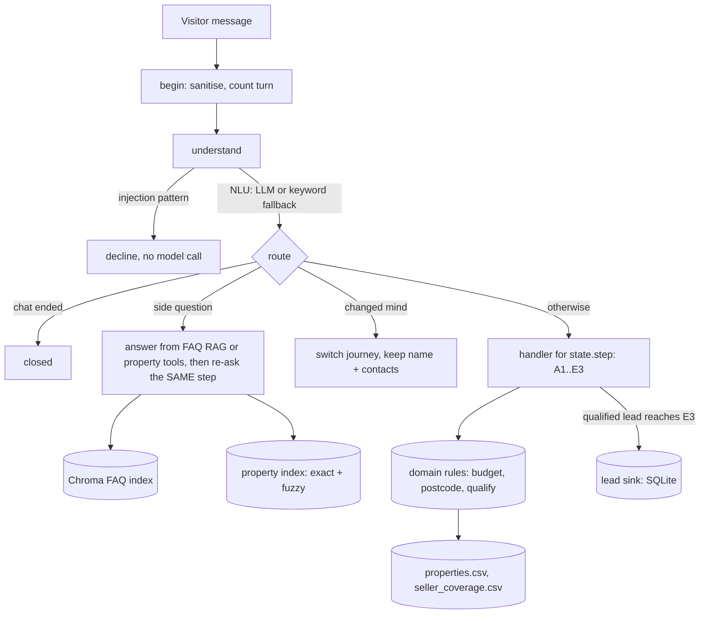

# Ashcombe & Rowe lead-qualification chatbot

An AI-agent chatbot that follows the agency's conversation flow (`docs/flowchart.png`) exactly,
qualifies visitors as leads against the agency's data, and hands qualified leads to the sales team.

> **Status:** all core requirements and all bonus items are built (lane C, FastAPI + Streamlit, Docker, tracing,
> eval harness) and have been run against a real model on Groq. The Dockerfile and Langfuse hook could not be
> exercised on the dev machine. See [Known limitations](#known-limitations).

## Tested with

| | |
|---|---|
| LLM provider / model | Groq, **`openai/gpt-oss-20b`** for development, tests and the live eval (free tier, tool calling, `reasoning_effort=low`); the sample transcripts were recorded with `openai/gpt-oss-120b` after the 20b model's daily token quota ran out. `llama-3.3-70b-versatile` was not available to the dev key (404), so it was not used. |
| Embeddings | Local ONNX model `BAAI/bge-small-en-v1.5` via fastembed (no key). The lexical fallback (below) is used if the model cannot download. |
| Python | 3.11 |

## Setup

```bash
python -m venv .venv && .venv/Scripts/activate        # Windows; use source .venv/bin/activate elsewhere
pip install -r requirements-dev.txt                   # runtime + UI + test dependencies (requirements.txt = runtime only)
pip install -e . --no-deps                            # makes `arbot` importable (needed for the CLI, API and eval)
cp .env.example .env                                  # then put your key in LLM_API_KEY
python -m arbot.cli                                   # chat in the terminal
pytest                                                # 266 tests, no API key needed
pytest -m live                                        # optional: real-LLM smoke tests (needs a key)
```

All configuration is read from environment variables (or a local `.env`, git-ignored). Variable names are
fixed by the brief: `LLM_PROVIDER`, `LLM_MODEL`, `LLM_API_KEY`, `LLM_BASE_URL`, `EMBEDDING_PROVIDER`,
`EMBEDDING_MODEL`, `EMBEDDING_API_KEY`. Supported providers: `groq`, `openai`, `gemini`, `openrouter`,
`cerebras`, `mistral`, `ollama`. Optional extras: `STRICT_FLOW`, `ENABLE_LANE_C`, `MAX_TURNS`, `LEAD_DB_PATH`,
`FAQ_DIRECT_THRESHOLD`, `FAQ_MIN_THRESHOLD`, `CHROMA_DIR`.

With **no** `LLM_API_KEY` the bot still runs in a rule-based *degraded mode* (see below).

### Run the backend and the UI

```bash
pip install -r requirements-ui.txt                     # UI extras (streamlit, requests)
uvicorn arbot.services.api:app --port 8000             # backend
streamlit run ui/streamlit_app.py                      # UI, talks to the backend at API_URL
```

API: `POST /sessions` -> `{session_id, reply}` (the greeting); `POST /chat {session_id, message}` ->
`{reply, step, ended, qualified}`; `GET /health` (shows `llm`, `model`, `degraded` and the last fallback reason; 
the server builds the bot at start-up, so it reports the real mode straight away). Session ids are server-issued and unguessable; unknown or expired
ids get 404; messages are capped at 1000 characters; requests are rate-limited per client (429 + `Retry-After`);
unexpected errors return a generic message and are logged server-side only. Set `CHECKPOINT_DB=sessions.db` so chats
survive a restart.

### Docker

```bash
cp .env.example .env        # add your key
docker compose up --build   # API on :8000, UI on :8501, data in the `chatdata` volume
```

One `Dockerfile`, two targets (`api`, `ui`): multi-stage, slim base, non-root user, health checks, no secrets baked
in. *Written but not built on the dev machine (Docker unavailable); the CI workflow does not build it yet.*

### Sample transcripts

[`docs/transcripts/`](docs/transcripts/README.md) holds nine recorded conversations: lanes A, B, C (available,
sold and re-qualified, ambiguous name) and D, an FAQ question mid-flow, the closing messages M1/M2/M3, change of
mind, invalid input, and prompt-injection attempts. They are produced by `python scripts/record_transcripts.py`
(real bot, real model; not hand-written) and were recorded with `openai/gpt-oss-120b` on Groq. The scripted visitor
uses fake phone and email values.

### Evaluation

```bash
python -m eval.run --mode keyword            # rule-based, no key, deterministic (also runs in CI)
python -m eval.run --mode auto --delay 4     # real LLM from .env, throttled for free-tier limits
```

29 scripted conversations (every lane, closing messages, side questions, injection, change of mind, invalid input,
first-message journeys) plus 4 natural-phrasing scenarios that only run with an LLM. Reports pass rate, p50/p95
latency per turn, LLM calls, tokens, estimated cost, degraded turns, and FAQ retrieval recall@1/@3/MRR (JSON in
`eval/reports/`).

| Run | Result |
|---|---|
| Rule-based (`--mode keyword`, also CI) | 29/29 scenarios |
| Live, `openai/gpt-oss-20b` on Groq + neural embeddings | **33/33 scenarios**; FAQ retrieval recall@1 = recall@3 = 1.0 (25 hand-written queries) |

**Read the live number with care.** Groq's free tier allows only 8,000 tokens per minute for this model, and the
live run hit 429s, after which the bot (by design) fell back to rule-based handling for those turns (the report
counts them as `degraded_turns`). Use `--delay 4` or more for a run that exercises the model on every turn. The
first live run, before the fixes below, scored 22/31, which is why the fixes exist.

**What the live run found that fakes could not:** the model answered a bare "no" with yes; labelled a property name
typed as an answer ("Apartment 1, Aldermoor Place") as a side question; labelled "not-an-email" as an FAQ question;
left `intent` empty for "any properties to buy on SW3 5WU?"; emitted malformed tool calls (`tool_use_failed`);
wrapped words in narrow no-break spaces; and could not parse "one point five million". Each is now handled in code
(deterministic fast path for short replies; side labels accepted only for question-like text; gaps filled from
rules; retry on malformed tool calls; space normalisation; spelled-out budgets) with a regression test in
`tests/graph/test_live_regressions.py`.

### Observability

Every turn appends one JSON line to `TURN_LOG_PATH` (step before/after, outcome, latency, LLM calls, tokens,
estimated cost, degraded flag, input length; **never the visitor's words**). Token usage is captured by a LangChain
callback registered through a context variable, so the NLU and the agent are measured without knowing about it.
Set `LANGFUSE_PUBLIC_KEY` / `LANGFUSE_SECRET_KEY` (and `pip install langfuse`) to add Langfuse traces grouped by
chat session; LangSmith works through its own `LANGCHAIN_*` variables. *Tracing hooks are unit-tested for gating
only; no Langfuse server was available.*

## Architecture

**Principle: the LLM is for language, code is for rules.** The flow is a business process, so it is a
deterministic LangGraph state machine. A model only (1) classifies what the visitor typed and (2) answers side
questions using read-only tools. Every qualification outcome comes from plain Python over the CSVs.



| Layer (`src/arbot/`) | Role | Knows about LLMs? |
|---|---|---|
| `domain/` | budget/postcode/phone/email parsing, qualification rules | No |
| `data/` | CSV loaders, property index, FAQ vector store | embeddings only |
| `nlu/` | understanding: `llm.py` (structured output) and `keyword.py` (rules, fallback) | yes / no |
| `graph/` | LangGraph build, one handler per flowchart step, fixed wording, guards | via `nlu/`, `agents/` |
| `agents/` | side-question tool-calling loop (`faq_search`, `find_property`, `get_property`) | yes |
| `llm/` | provider factory, retries, backoff, circuit breaker | yes |
| `services/` | lead hand-off | No |

### Key design decisions

1. **State machine + LLM for language.** Exact flow, testable without a model, immune to prompt-injected rule
   changes. Alternative (a pure ReAct agent with the flowchart in the prompt) is non-deterministic and injectable.
2. **LangGraph, one invocation per message, an explicit `step` pointer.** A side question never touches `step`,
   so "answer then resume" is structural, not prompt-dependent. State is in a checkpointer keyed by `thread_id`.
3. **Regex first, LLM second, code decides.** Budgets, postcodes, phones and emails are parsed deterministically;
   the LLM is not even called when a parser recognises the answer. The model returns closed vocabularies only.
4. **Fixed flow wording.** Every question and closing message (M1/M2/M3) is a constant from the flowchart.
5. **Three data sources, three retrieval methods.** Seller postcodes: exact set match (a semantic match could
   wrongly accept a neighbouring postcode). Listings: exact filter for qualification; token fuzzy match for
   "which property?" (embeddings blur "Apartment 2" vs "Apartment 3"). FAQ: embeddings, because visitors paraphrase.
6. **FAQ RAG, question-only embeddings.** Answers mention many branches and would match any branch query.
   High similarity returns the stored answer verbatim (no LLM, no hallucination); below a floor returns
   "not in my data + office number"; in between a tool-calling agent answers from tool output only.
7. **Degraded mode.** If the LLM is down, rate-limited (free tiers are) or unconfigured, NLU falls back to
   keyword rules and side answers fall back to the top FAQ hit or a deterministic property fact sheet.
   Qualification never needed the model, so it keeps working.

### Business rules (all in `domain/qualify.py`)

- New-build: budget `>= £1,000,000` else **M1** (checked before the postcode is asked) -> a new-build listed at
  the postcode (any status) else **M2** -> an *available* one within budget else **M3**.
- Resale: budget recorded, never filters. Resale listed at postcode else **M2**; none available else **M3**.
- Seller: postcode in `seller_coverage.csv` else **M2**. Lane E (contact details) is reachable **only** after
  a qualified outcome (asserted in code and fuzz-tested).
- Only `available` listings are ever shown; `under_offer` and `sold` are both "not available".

### Assumptions

1. Matches are the cheapest first, then by id, up to 5.
2. Lane C: "Property type?" (C6) is read from the found listing instead of being asked.
3. A property named in the first message: the bot still asks the name once (flowchart's first boxes), then skips
   "buy or sell" and "specific property?".
4. Postcodes must be **full** (the FAQ says coverage is confirmed at full-postcode level).
5. After M1/M2/M3 the chat is closed; a new chat is a new thread.
6. On a second qualified journey in one chat, phone and email already given are not asked again.
7. Several budget figures ("1-2m", "£400k or £5m") are clarified, never guessed.
8. If the visitor volunteers answers early ("new-build in SW3, £2m") they are kept but every check still runs in
   flowchart order. `STRICT_FLOW=1` always asks every question verbatim.

### Embeddings and the offline fallback

The default embedding model is a small local ONNX model downloaded **once** from Hugging Face on first use.
Corporate networks that re-sign HTTPS traffic make this (and every LLM call) fail with `CERTIFICATE_VERIFY_FAILED`,
which is what happened on the dev machine. The app therefore trusts the **operating system's certificate store** at
start-up (`USE_SYSTEM_CERTS=true`, via `truststore`): verification stays on, it just uses the company certificate
your OS already trusts. It also sets `HF_HUB_DISABLE_XET=1`, because Hugging Face's Xet transfer fails behind some
proxies ("Byte range not sequential"). With both, the neural model downloads and works. If it still cannot load:

1. Point Python at your organisation's CA bundle (`SSL_CERT_FILE` / `REQUESTS_CA_BUNDLE`) and retry; or
2. Use a hosted embedding model: `EMBEDDING_PROVIDER=openai|gemini` with `EMBEDDING_API_KEY`; or
3. Use the built-in **lexical fallback** `HashEmbedder` (hashed bag of words, no download):
   it is selected automatically (with a logged warning) when the model cannot load, or explicitly with
   `EMBEDDING_PROVIDER=hash`.

The fallback matches shared words, not meaning, so paraphrased FAQ questions are less reliable. To stay safe it
never returns an answer verbatim on its own and uses a low-similarity floor so unrelated questions get the
"not in my data, call 020 7946 0100" reply. Retrieval quality of the fallback is covered by `tests/unit/test_faq_store.py`.
FAQ thresholds were calibrated on the neural model with 25 hand-written queries: correct top-1 matches scored
>= 0.675, unrelated questions <= 0.567, so the "not in my data" floor is 0.62 (`FAQ_MIN_THRESHOLD`) and answers at
>= 0.82 are returned verbatim (`FAQ_DIRECT_THRESHOLD`). The margin is thin and the set is small; re-check it if you
change the model or the FAQ.

## Production hardening

| Risk | Handled now | With more time |
|---|---|---|
| Prompt injection / rule override | Outcomes come from code; closed-vocabulary model output; injection patterns declined with no model call; visitor text delimited as data; tests with a model that *obeys* every attack | Classifier model, red-team suite in CI |
| Hallucinated facts | Tool-only grounding; "not in my data" + office number; verbatim FAQ path; output guard allows only company phone/email/URLs and blocks prompt leakage | Faithfulness evals, FAQ-id citations |
| LLM outage / 429s | Retries with backoff + jitter, `Retry-After`, circuit breaker, degraded mode | Multi-provider failover |
| PII | Lead record only at E3; PII masking helper for logs; user text is not logged | Consent capture, retention jobs, encryption at rest |
| Abuse / runaway chats | Input length cap, per-chat turn cap | API rate limiting, CAPTCHA, per-IP cost budgets |
| CRM failure | Lead sink errors are logged and never break the chat | Retry queue / outbox |
| Stale availability | CSV read at start-up | Live listings source; re-check at hand-off |

## Known limitations

- Live testing used one model (`openai/gpt-oss-20b`). It is a reasoning model, so a turn that needs the LLM takes
  roughly 1-8 s; other models and providers (OpenAI, Gemini) were not run.
- Groq's free tier (8,000 tokens/minute here) rate-limits a busy session; the bot degrades to rules instead of failing.
- The FAQ thresholds rest on a small hand-written query set.
- The keyword fallback NLU is English-only and simple; the LLM path is the intended experience.
- Sessions use an in-memory checkpointer (lost on restart); the lead store is SQLite.
- The Dockerfile is unverified (no Docker on the dev machine); Langfuse tracing is untested against a real server.
- Rate limiting and the session registry are in-process; with several API workers they need Redis.
- The eval's natural-phrasing scenarios have not been run against a real model yet.

## Tests

`pytest` runs 266 tests: parsers (incl. property-based), every qualification outcome and boundary, every path of
the flowchart, FAQ-mid-flow at every step, lane C, change of mind, strict mode, resilience (retry/circuit breaker),
LLM-NLU guards, FAQ retrieval, the tool-calling agent with scripted models, injection/obedient-model security
tests, lead hand-off, the HTTP API (isolation, limits, error hygiene), observability, SQLite session persistence,
the Streamlit UI (via Streamlit's test runner), the eval harness itself, and a fuzz test asserting contact details are
only ever collected after qualification.
